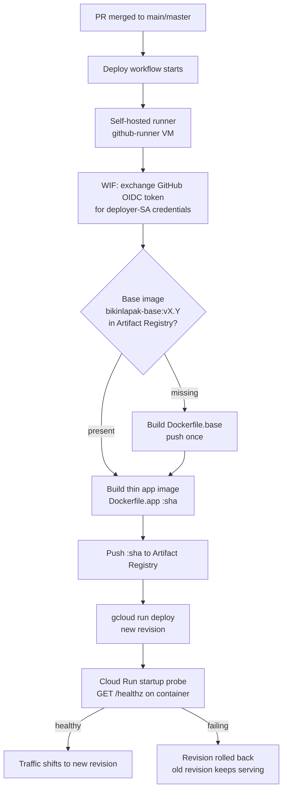
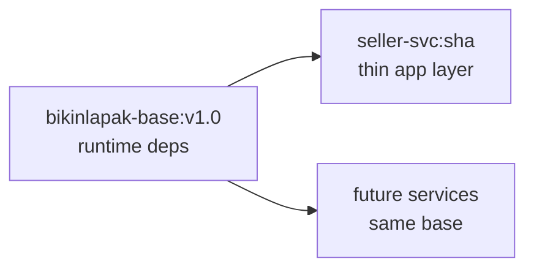

# Deployment

How code gets from a merged pull request to a running Cloud Run revision, and
how to deploy by hand when the pipeline is not available.

- **Project**: `project-9567c06f-f9aa-4397-a2c` (worksh playground), region
  `asia-southeast2` (Jakarta)
- **Services**: `seller-svc-staging` (this repo) and `gcp-boilerplate-staging`
  (pipeline reference project)
- **Environment suffix**: `staging` — one GCP project per environment is the
  long-term plan (see `infra/README.md`); everything below currently lives in
  the playground project

## The pipeline (merge → Cloud Run)



Only steps inside the dashed box below are the workflow's job — everything
else is owned by Terraform (`infra/`):

```mermaid
flowchart LR
    subgraph GH [GitHub]
        R1[bikinlapak/seller-svc]
        R2[bikinlapak/gcp-boilerplate]
    end
    subgraph GCP [GCP project: worksh playground]
        VM[github-runner VM<br/>asia-southeast1-c<br/>e2-medium, Debian 13]
        WIF[WIF pool github-staging<br/>fenced to org bikinlapak]
        DEP[deployer-staging SA]
        AR[Artifact Registry<br/>bikinlapak-staging]
        CRS[Cloud Run<br/>seller-svc-staging]
        CRB[Cloud Run<br/>gcp-boilerplate-staging]
        SM[Secret Manager<br/>action-key secret]
    end
    R1 --> VM
    R2 --> VM
    VM --> WIF --> DEP
    DEP -->|push images| AR
    DEP -->|deploy revisions| CRS
    DEP -->|deploy revisions| CRB
    CRS --> SM
```



## Image strategy: fat base + thin app

Two Dockerfiles per service, the [2fa-gateway] pattern:

| Image | Contents | Rebuilt |
| ----- | -------- | ------- |
| `bikinlapak-base:v1.0` | `debian:bookworm-slim` + `ca-certificates` (runtime deps) | Once per dependency/OS bump — bump the tag (`v1.1`, `v2.0`) everywhere it is referenced |
| `seller-svc:<sha>` | Rust build in pinned `rust:1.97-bookworm` stage, binary copied onto the base | Every deploy |



Adding a runtime dependency later = edit `Dockerfile.base`, bump the tag —
app builds never run `apt` again.

## Authentication: no keys anywhere

GitHub Actions authenticates via **Workload Identity Federation**: the
workflow requests an OIDC token (`permissions: id-token: write`), which GCP
exchanges for short-lived `deployer-staging` credentials. The WIF provider is
fenced with `attribute_condition` to the `bikinlapak` org, and each repo gets
its own binding — see `infra/github.tf`.

The deployer may push images and deploy revisions, and may act **as** the
runtime service accounts — nothing more.

## Manual deployment (Makefile)

The `Makefile` runs the identical flow through your local `gcloud` CLI. The
project is pinned to the playground, so it works regardless of a developer's
local `gcloud` config.

```sh
gcloud auth login && gcloud auth application-default login   # once
make grants GRANT_USER=<dev-email>                           # owner, once per dev

make release      # local build path (needs docker with BuildKit)
make vm-release   # build on the runner VM (no local docker needed)
make health       # probe /health on the deployed service
```

| Target | What it does |
| ------ | ------------ |
| `grants` | Owner-only: grants a developer AR writer, run.developer, actAs + tokenCreator on the runtime SA |
| `auth` | `gcloud auth configure-docker` for Artifact Registry |
| `base` / `vm-base` | Verify `bikinlapak-base:vX.Y` exists; build+push if missing |
| `build` / `vm-build` | Thin app image, tagged with the commit SHA |
| `push` / `vm-push` | Push to Artifact Registry |
| `deploy` | `gcloud run deploy` a new revision (explicit `--service-account`) |
| `health` | `GET /health` with an SA-impersonated identity token |
| `release` / `vm-release` | The whole chain, local or on the VM |

The `vm-*` targets sync the build context to
`/mnt/storage/workspace/deployment/seller-svc-manual` on the runner VM and
run `scripts/vm-*.sh` there — useful on laptops without BuildKit.

## Health checks

- `GET /healthz` — used by Cloud Run's startup/liveness probes, which hit the
  container directly and bypass the public edge.
- `GET /health` — the externally probeable alias. Google's frontend
  intercepts the exact path `/healthz` on public `*.run.app` URLs (its own
  404, even with valid auth), so use `/health` from outside.

seller-svc is **not** public: calls need an identity token from a principal
holding `roles/run.invoker`.

```sh
URL=https://seller-svc-staging-hv4r3oooeq-et.a.run.app
T=$(gcloud auth print-identity-token \
    --impersonate-service-account=seller-svc-staging@project-9567c06f-f9aa-4397-a2c.iam.gserviceaccount.com \
    --audiences=$URL)
curl -H "Authorization: Bearer $T" $URL/health
```

## GitHub Actions variables

Six **variables** (not secrets — nothing sensitive) per repo, values printed
by `terraform output next_steps`:

`WIF_PROVIDER`, `WIF_SERVICE_ACCOUNT`, `GCP_PROJECT_ID`, `GCP_REGION`,
`AR_REPO`, `ENV_NAME`.

## The runner VM

| Thing | Value |
| ----- | ----- |
| Instance | `github-runner`, `asia-southeast1-c`, e2-medium (2 vCPU / 4 GB) + 4 GB swap |
| OS | Debian 13 (trixie) |
| Docker data-root | `/mnt/storage/workspace/docker` (20 GB second disk) |
| Runner install | `~/runner` (repo runner for `bikinlapak/gcp-boilerplate`) |

Ops notes learned the hard way:

- **Docker 29 defaults to the containerd snapshotter**, which stores images in
  `/var/lib/containerd` on the *system* disk regardless of `data-root` — it
  filled 9.7 GB in a day. Fixed with
  `"features": {"containerd-snapshotter": false}` in `/etc/docker/daemon.json`.
- The VM's service account has `cloud-platform` scope; its token works for
  manual `docker login` pushes.
- `gcloud auth configure-docker` on the VM writes a credential helper that
  breaks manual pushes with WIF leftovers — removed from `~/.docker/config.json`;
  the workflow re-adds it per job, where it works.

## Known gotchas

- **`PORT` is reserved** on Cloud Run — setting it in the template is a 400.
  Listen on 8080.
- **`gcloud run deploy` on a NEW service** defaults to the compute engine SA,
  which the deployer may not `actAs` — always pass `--service-account`.
- **The action-key secret must be base64** (PKCS#8 DER inside): Cloud Run
  rejects binary env values and `config.rs` decodes base64 itself. Currently a
  blank value is stored, so the service runs with an ephemeral signing key —
  fine for deploys, but action tokens die on every restart. Fix properly when
  wiring the real key (also note: ring's strict `from_pkcs8` rejects
  openssl's v2-format keys).
- **Self-hosted runners are repo-scoped**: the runner registered to
  `gcp-boilerplate` does not pick up `seller-svc` jobs. A second runner (or an
  org-level runner) is needed for seller-svc's workflow.

[2fa-gateway]: https://github.com/bqsecurities/kisi-2fa-gateway
