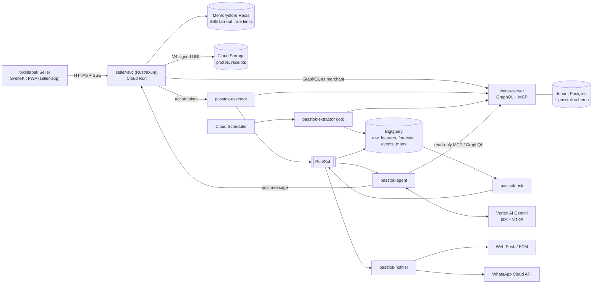

# 01 — Architecture

## Topology



## Cargo workspace layout

`seller-svc` becomes a workspace. The existing `src/` moves into
`crates/seller-svc/` — a mechanical move; keep the git history with `git mv`.

```plain text
seller-svc/
  Cargo.toml                 [workspace] members + shared dependency versions
  crates/
    seller-svc/              BFF binary — the only crate seller-app talks to
      src/
        main.rs  lib.rs  config.rs  error.rs
        auth/                OTP, Google, session cookies, works.io token refresh
        routes/
          health.rs
          onboarding.rs      wizard steps, publish pre-flight
          products.rs        list/detail/create/edit, images, AI listing suggest
          stock.rs           by location, lots, adjust, opname
          suppliers.rs       suppliers + supplier_terms
          purchase_orders.rs list/detail/create/submit/receive
          orders.rs          cross-channel orders, fulfilment
          reports.rs         summary, waste, monthly
          assistant.rs       thread, SSE stream, messages, settings
          actions.rs         POST /actions/:token → executor
          waste.rs           photo URL, analyze, confirm, destinations
          recipients.rs      partner + own recipient list
          donations.rs       donation + receipt PDF
          push.rs            Web Push subscribe/unsubscribe
        sse/                 broadcast channel + Redis pub/sub bridge
        aggregate/           home and report aggregates (fan-out + join)
    passtok-executor/        verifies action tokens, runs worksh.io mutations
    passtok-extractor/       worksh.io → BigQuery (Cloud Run job)
    passtok-risk/            reorder + expiry + production rules → events
    passtok-agent/           Vertex tool loop: cards, Q&A, vision, daily special
    passtok-notifier/        push, WhatsApp template, digest scheduler
    passtok-core/            shared: config, logging, otel, events, token,
                             money (Idr), ids (ULID), outbox, pubsub, gcs,
                             bigquery, gemini, errors
    passtok-worksh/          generated GraphQL client (cynic) + typed operations
  sql/
    bigquery/                tables, views, scheduled queries (forecast, marts)
    passtok/                 sqlx migrations for the passtok schema
  schemas/                   JSON Schema per event; Rust types via typify
  infra/                     Terraform: project, Run, Pub/Sub, BQ, GCS, Redis,
                             IAM, secrets (covers seller-app's Run service too)
  seed/                      demo data generator (Toko Kopi Jasa, 90 days)
  docs/
    plan/                    this plan
    adr/                     decision records
    runbooks/                on-call + demo reset
```

### Why a workspace rather than six repos

One `cargo test` across every rule, one lockfile, one `cargo clippy` gate, and
`passtok-core` changes compile against all consumers immediately. Each crate
still builds its own container (`cargo build -p passtok-risk`), so deploy units
stay independent.

## Crate responsibilities

| Crate               | Owns                                                                                                                                                                                | Never does                          |
| ------------------- | ----------------------------------------------------------------------------------------------------------------------------------------------------------------------------------- | ----------------------------------- |
| `seller-svc`        | Merchant session (worksh.io tokens), screen-shaped endpoints, SSE stream, photo upload URLs, message persistence via worksh.io                                                      | Call Gemini; hold business rules    |
| `passtok-executor`  | Token verify (tenant, action, qty cap, expiry, `jti`), permission check, idempotent mutation, result card, `decision.recorded` / `waste.recorded` / `donation.completed` via outbox | Act without a token                 |
| `passtok-extractor` | Backfill + 15-minute incremental sync of movements, stock, lots, products, suppliers, POs                                                                                           | Write to worksh.io                  |
| `passtok-risk`      | Reorder point, expiry cap, pack rounding, lot sell-through, production plan, markdown ladder schedule; emits events                                                                 | Generate text                       |
| `passtok-agent`     | Turns events into cards, answers chat, vision extraction + grounded matching, daily-special ideas; signs action tokens                                                              | Write to worksh.io; invent numbers  |
| `passtok-notifier`  | Push subscriptions, escalation ladder, quiet hours, morning digest, weekly impact digest                                                                                            | Send full conversations to WhatsApp |
| `passtok-core`      | Cross-cutting plumbing only                                                                                                                                                         | Contain any domain rule             |
| `passtok-worksh`    | Typed worksh.io operations                                                                                                                                                          | Interpret results                   |

The two rows that carry the safety property are `passtok-agent` (no write
capability at all — it has no works-server write scope and no executor
credentials, only a signing key) and `passtok-executor` (refuses to act without
a valid, unused token). Keep them in separate crates so "can this code write?"
is answerable by reading the dependency list.

## Request paths worth knowing

**A suggestion becomes a purchase order.** `passtok-risk` emits
`reorder.suggested` → Pub/Sub → `passtok-agent` writes a `reorder_card` message
and a `suggestions` row, signs an action token scoped to
`(tenant, suggestion, action, max_qty, exp, jti)` → BFF pushes the card over SSE
→ merchant edits the quantity and taps _Setujui_ → `POST /actions/:token` with
the final quantity → `passtok-executor` verifies the token, checks the quantity
against `max_qty`, marks the `jti` used in the same transaction as the mutation,
calls `createPurchaseOrder` + `submitPurchaseOrder`, writes a `result_card` and
a `decision.recorded` outbox row.

The quantity cap matters: the merchant may edit _down_ within the cap, never up,
so an edited approval cannot exceed what the agent proposed.

**A photo becomes a write-off.** Camera in the PWA → `POST /waste/photos`
returns a V4 signed PUT URL (per-tenant prefix) → browser uploads straight to
GCS → `POST /waste/analyze` → agent calls Gemini with the photo plus candidate
products from the tenant's catalog (perishable, in stock, near expiry first) and
gets structured output back → grounded matching accepts only candidate IDs →
confirm card → `POST /waste/confirm` → executor `adjustStock` with a `waste:*`
or `dest:*` reason and the photo as evidence.

**Realtime.** One `tokio::sync::broadcast` channel per `(tenant, thread)` inside
each BFF instance, plus a Redis pub/sub subscription that republishes messages
from other instances into the local channel. SSE handlers wrap the receiver in a
`BroadcastStream`. Lagged receivers get a `resync` event rather than a silent
gap, and the client refetches the thread.

## Deploy units

| Unit                | Kind              | Trigger                        | Scaling                       |
| ------------------- | ----------------- | ------------------------------ | ----------------------------- |
| `seller-app`        | Cloud Run service | HTTPS                          | min 0 (min 1 during the demo) |
| `seller-svc`        | Cloud Run service | HTTPS                          | min 1 — SSE connections       |
| `passtok-executor`  | Cloud Run service | HTTPS from BFF (internal, IAM) | min 0                         |
| `passtok-risk`      | Cloud Run service | Pub/Sub push + Scheduler       | min 0                         |
| `passtok-agent`     | Cloud Run service | Pub/Sub push + internal HTTP   | min 0                         |
| `passtok-notifier`  | Cloud Run service | Pub/Sub push + Scheduler       | min 0                         |
| `passtok-extractor` | Cloud Run **job** | Scheduler, every 15 min        | —                             |

Pub/Sub push beats pull here: no long-lived subscriber, Cloud Run scales to
zero, and each push carries an OIDC token the service verifies. Every service
gets its own service account; only `passtok-executor` holds a works-server token
with write scope.

Region: `asia-southeast2` (Jakarta) where available, falling back to
`asia-southeast1` for Vertex AI models that are not in Jakarta. Record the
per-model choice in an ADR — it affects latency in the demo.

## ADRs to write in Phase 0

- **ADR-0001** — One app, two repos, one Cargo workspace (supersedes the Notion
  monorepo layout).
- **ADR-0002** — Rust instead of Go; no ADK, hand-rolled tool loop.
- **ADR-0003** — `passtok` schema ownership: lives in the tenant Postgres, owned
  by worksh.io, written only by BFF/executor.
- **ADR-0004** — Action-token format and signing (Ed25519 JWT, single use).
- **ADR-0005** — Event naming and versioning (`<noun>.<verb_past>`, `v` field).
- **ADR-0006** — Vertex AI model + region per task (chat, vision, special).
